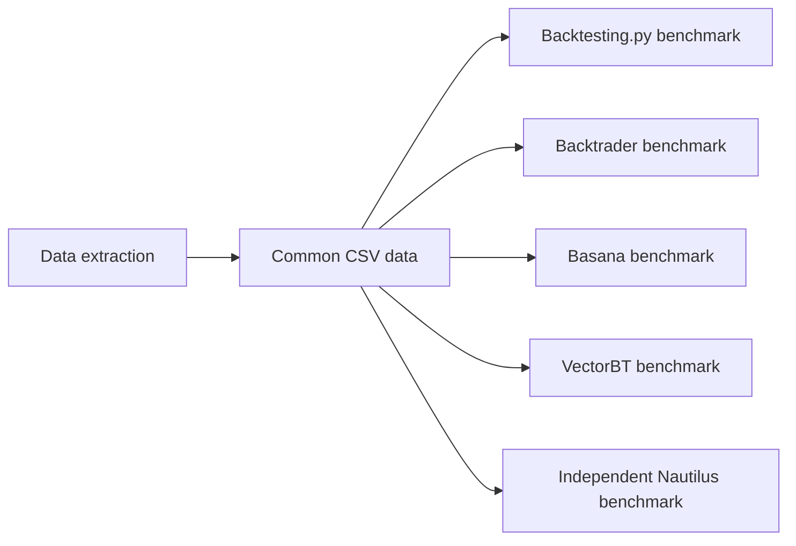
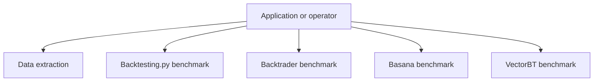
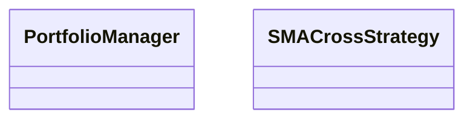
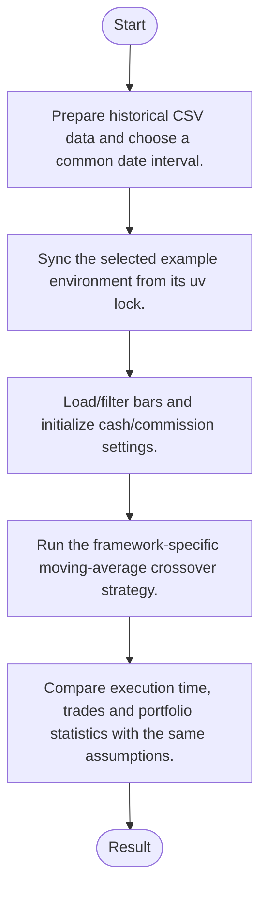
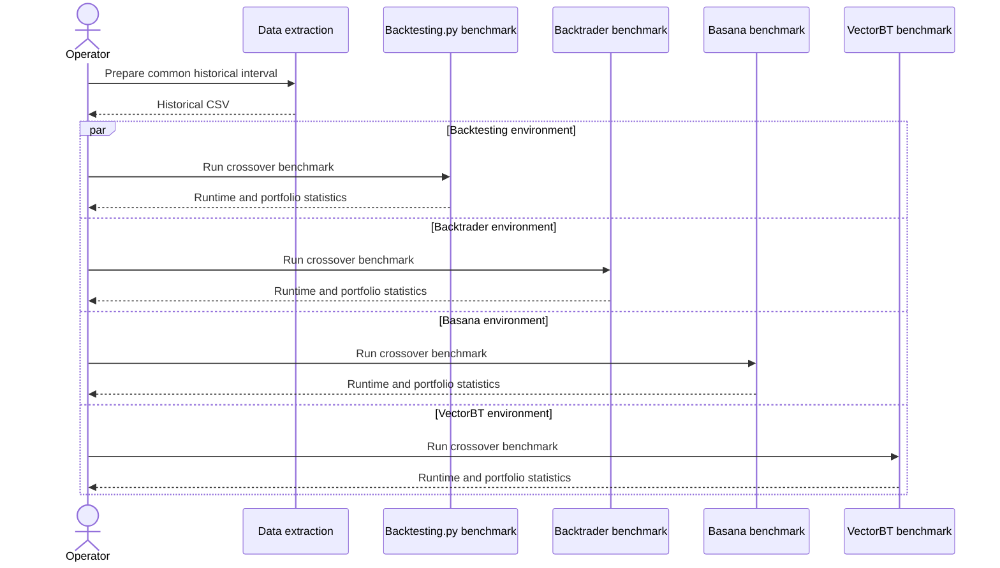
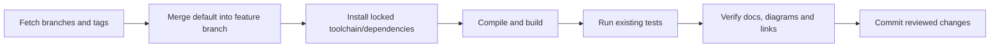

# system-comparison: architecture, features and workflows

Updated: 2026-10-12 · Branch: `feature/ayu_develop` · Source snapshot: `964081a`

[Development and layout](development.md) · [Validation evidence](validation.md) · [HTML edition](ayu-develop.html)

## Purpose and scope

A comparison and benchmark repository containing common historical data and separate Python examples for Backtesting.py, Backtrader, Basana, Nautilus and VectorBT. The examples implement moving-average crossover strategies and report runtime and trading results. Each framework environment is independent so compatibility constraints do not contaminate the others.

## Features

- Common CSV input and date filtering enable comparable runs.
- Moving-average crossover examples expose cash and commission assumptions.
- Each example declares its own framework dependencies and uv lock.
- Data preparation is separated from engine execution.
- The README and research documents describe framework characteristics beyond numerical runtime.

## Components and responsibilities

| Component | Responsibility | Implementation |
| --- | --- | --- |
| Data extraction | Prepares the benchmark historical-data input | [scripts/extract_data.py](../scripts/extract_data.py) |
| Backtesting.py benchmark | Runs the Strategy init/next API over prepared bars | [examples/backtesting.py/benchmark.py](../examples/backtesting.py/benchmark.py) |
| Backtrader benchmark | Runs the Cerebro/Strategy broker loop | [examples/backtrader/benchmark.py](../examples/backtrader/benchmark.py) |
| Basana benchmark | Dispatches bar events and portfolio signals | [examples/basana/benchmark.py](../examples/basana/benchmark.py) |
| VectorBT benchmark | Constructs arrays of indicators and portfolio signals | [examples/vectorbt/benchmark.py](../examples/vectorbt/benchmark.py) |

## Architecture and boundaries

The following view shows the principal responsibilities and their data-flow relationship. It is a conceptual architecture view; each implementation link above identifies the owning source. Native or external services retain their own lifecycle and configuration.



### Component ownership

The boundaries below distinguish entry points from their state/model and integration responsibilities. Data validation, numerical semantics and external protocol handling belong in the owning modules rather than in documentation or deployment scripts.



## Types and relationships

This diagram names types present in the linked source. Edges describe the documented relationship; they do not imply additional inheritance.



- [`PortfolioManager`](../examples/basana/benchmark.py)
- [`SMACrossStrategy`](../examples/backtesting.py/benchmark.py)

## Runtime workflow

1. Prepare historical CSV data and choose a common date interval.
2. Sync the selected example environment from its uv lock.
3. Load/filter bars and initialize cash/commission settings.
4. Run the framework-specific moving-average crossover strategy.
5. Compare execution time, trades and portfolio statistics with the same assumptions.



## Sequence of a typical operation

This sequence expands the responsibility flow described above. The named participants correspond to the component table; error handling and any service-specific prerequisites remain part of the implementation.



## Development and verification workflow

Sync the upstream refs, merge the actual default branch into `feature/ayu_develop`, resolve conflicts, install the documented environment and run the existing build/test commands. Keep lockfiles and source changes together so another checkout can reproduce the environment.



### Commands

```sh
uv sync --locked
uv run --project examples/backtesting.py python examples/backtesting.py/benchmark.py --help
uv run --project examples/vectorbt python examples/vectorbt/benchmark.py --help
```

The exact commands executed, interpreter/compiler versions, pass/fail counts and any prerequisites are recorded in [validation.md](validation.md). A syntax-only pass is reported separately from a package/native build and from runtime tests.

## Source navigation

These links refer to files in this checkout. They remain useful when the repository is opened locally; the source snapshot above identifies the revision used for this guide.

- [scripts/extract_data.py](../scripts/extract_data.py)
- [examples/backtesting.py/benchmark.py](../examples/backtesting.py/benchmark.py)
- [examples/backtrader/benchmark.py](../examples/backtrader/benchmark.py)
- [examples/basana/benchmark.py](../examples/basana/benchmark.py)
- [examples/vectorbt/benchmark.py](../examples/vectorbt/benchmark.py)
- [examples/backtesting.py/pyproject.toml](../examples/backtesting.py/pyproject.toml)
- [examples/backtrader/pyproject.toml](../examples/backtrader/pyproject.toml)
- [examples/basana/pyproject.toml](../examples/basana/pyproject.toml)
- [examples/nautilus_trader/benchmark.py](../examples/nautilus_trader/benchmark.py)
- [examples/nautilus_trader/pyproject.toml](../examples/nautilus_trader/pyproject.toml)
- [examples/vectorbt/pyproject.toml](../examples/vectorbt/pyproject.toml)
