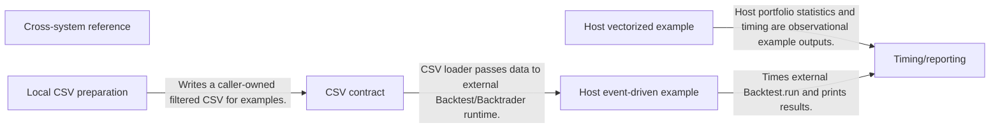
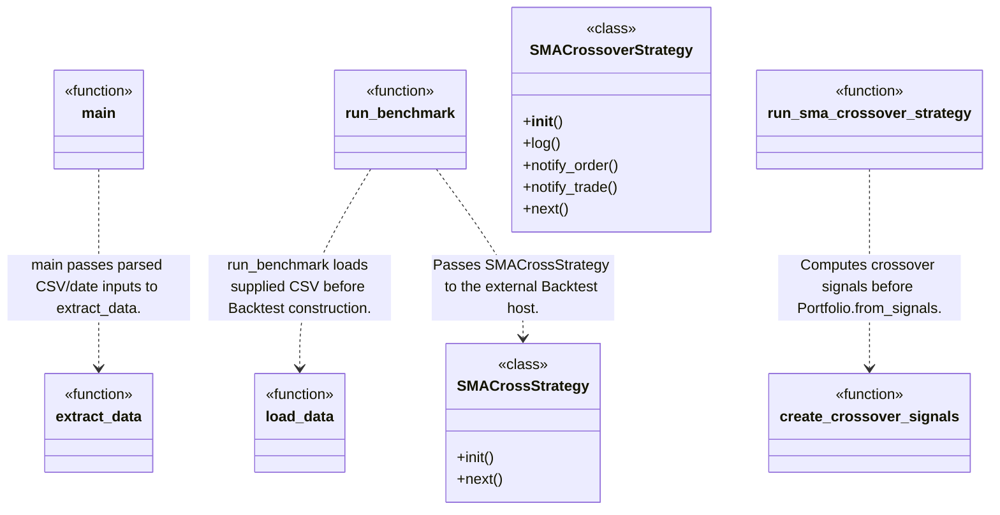
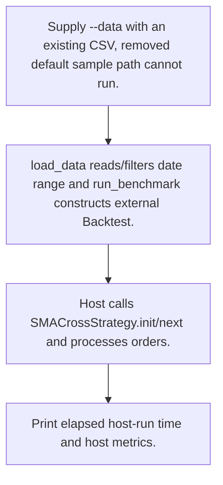
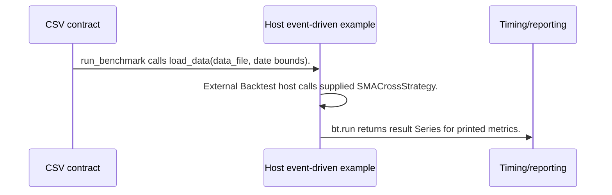

# Trading System Comparison: workflow, design and architecture

Updated: **2026-10-13**
Reviewed Git hash: `d42438792ef986e6de005b685d75396225ade132`
Branch: `feature/ayu_develop`
Source diff SHA256: `0b2d2e8e2a5a8d8e432b6d863d609f20553f02eef7535fb1817d07e156324284`
Scope: **Comparison examples and documentation** / Maintenance: **companion**
Languages: Python, Markdown

[HTML edition](ayu-develop.html) / [Development](development.md) / [Historical validation](validation.md) / [Full system comparison](../../docs/index.html)

The review includes existing local source changes. The Git hash identifies the committed base; audited file hashes below identify the actual files read.

## Purpose and scope

Cross-system reference and framework-specific SMA examples plus a local CSV extraction utility; this repository delegates simulation to installed frameworks and bundles no current sample data.

## Features and support boundaries

Native = implemented here. Integration = supplied through a named host/API. Limited = material restriction. Not provided = evidenced scope exclusion. Unverified = support/absence not established. Not applicable = outside this artifact type.

| Capability | Status | Implementation and limits | Source |
|---|---|---|---|
| Backtesting | Integration | Example strategies invoke installed Backtesting.py/Backtrader; fill/accounting/results belong to those hosts, not this comparison repository. | [run_benchmark](../examples/backtesting.py/benchmark.py) ([L90](https://github.com/alexcwyu/trading-system-comparison/blob/d42438792ef986e6de005b685d75396225ade132/examples/backtesting.py/benchmark.py#L90)) / [SMACrossStrategy](../examples/backtesting.py/benchmark.py) ([L39](https://github.com/alexcwyu/trading-system-comparison/blob/d42438792ef986e6de005b685d75396225ade132/examples/backtesting.py/benchmark.py#L39)) / [SMACrossoverStrategy](../examples/backtrader/benchmark.py) ([L22](https://github.com/alexcwyu/trading-system-comparison/blob/d42438792ef986e6de005b685d75396225ade132/examples/backtrader/benchmark.py#L22)) |
| Live execution | Not provided | Comparison/examples depend on local historical CSV and delegate host simulation; no repository-owned live/paper venue runtime is established. | [README.md](../README.md) / [run_benchmark](../examples/backtesting.py/benchmark.py) ([L90](https://github.com/alexcwyu/trading-system-comparison/blob/d42438792ef986e6de005b685d75396225ade132/examples/backtesting.py/benchmark.py#L90)) / [pyproject.toml](../pyproject.toml) ([L6](https://github.com/alexcwyu/trading-system-comparison/blob/d42438792ef986e6de005b685d75396225ade132/pyproject.toml#L6)) |
| Paper trading | Not provided | Comparison/examples depend on local historical CSV and delegate host simulation; no repository-owned live/paper venue runtime is established. | [README.md](../README.md) / [run_benchmark](../examples/backtesting.py/benchmark.py) ([L90](https://github.com/alexcwyu/trading-system-comparison/blob/d42438792ef986e6de005b685d75396225ade132/examples/backtesting.py/benchmark.py#L90)) / [pyproject.toml](../pyproject.toml) ([L6](https://github.com/alexcwyu/trading-system-comparison/blob/d42438792ef986e6de005b685d75396225ade132/pyproject.toml#L6)) |
| Event driven | Integration | Example strategies invoke installed Backtesting.py/Backtrader; fill/accounting/results belong to those hosts, not this comparison repository. | [run_benchmark](../examples/backtesting.py/benchmark.py) ([L90](https://github.com/alexcwyu/trading-system-comparison/blob/d42438792ef986e6de005b685d75396225ade132/examples/backtesting.py/benchmark.py#L90)) / [SMACrossStrategy](../examples/backtesting.py/benchmark.py) ([L39](https://github.com/alexcwyu/trading-system-comparison/blob/d42438792ef986e6de005b685d75396225ade132/examples/backtesting.py/benchmark.py#L39)) / [SMACrossoverStrategy](../examples/backtrader/benchmark.py) ([L22](https://github.com/alexcwyu/trading-system-comparison/blob/d42438792ef986e6de005b685d75396225ade132/examples/backtrader/benchmark.py#L22)) |
| Vectorized | Integration | VectorBT example delegates MA arrays and signal portfolios to installed vectorbt. | [run_sma_crossover_strategy](../examples/vectorbt/benchmark.py) ([L119](https://github.com/alexcwyu/trading-system-comparison/blob/d42438792ef986e6de005b685d75396225ade132/examples/vectorbt/benchmark.py#L119)) / [create_crossover_signals](../examples/vectorbt/benchmark.py) ([L85](https://github.com/alexcwyu/trading-system-comparison/blob/d42438792ef986e6de005b685d75396225ade132/examples/vectorbt/benchmark.py#L85)) |
| Order management | Integration | Example strategies invoke installed Backtesting.py/Backtrader; fill/accounting/results belong to those hosts, not this comparison repository. | [run_benchmark](../examples/backtesting.py/benchmark.py) ([L90](https://github.com/alexcwyu/trading-system-comparison/blob/d42438792ef986e6de005b685d75396225ade132/examples/backtesting.py/benchmark.py#L90)) / [SMACrossStrategy](../examples/backtesting.py/benchmark.py) ([L39](https://github.com/alexcwyu/trading-system-comparison/blob/d42438792ef986e6de005b685d75396225ade132/examples/backtesting.py/benchmark.py#L39)) / [SMACrossoverStrategy](../examples/backtrader/benchmark.py) ([L22](https://github.com/alexcwyu/trading-system-comparison/blob/d42438792ef986e6de005b685d75396225ade132/examples/backtrader/benchmark.py#L22)) |
| Order types | Integration | Example issues host buy/sell/close requests only; it does not prove all order types supported by every compared system. | [SMACrossStrategy](../examples/backtesting.py/benchmark.py) ([L39](https://github.com/alexcwyu/trading-system-comparison/blob/d42438792ef986e6de005b685d75396225ade132/examples/backtesting.py/benchmark.py#L39)) / [SMACrossoverStrategy](../examples/backtrader/benchmark.py) ([L22](https://github.com/alexcwyu/trading-system-comparison/blob/d42438792ef986e6de005b685d75396225ade132/examples/backtrader/benchmark.py#L22)) |
| Multi venue | Not provided | Comparison/examples depend on local historical CSV and delegate host simulation; no repository-owned live/paper venue runtime is established. | [README.md](../README.md) / [run_benchmark](../examples/backtesting.py/benchmark.py) ([L90](https://github.com/alexcwyu/trading-system-comparison/blob/d42438792ef986e6de005b685d75396225ade132/examples/backtesting.py/benchmark.py#L90)) / [pyproject.toml](../pyproject.toml) ([L6](https://github.com/alexcwyu/trading-system-comparison/blob/d42438792ef986e6de005b685d75396225ade132/pyproject.toml#L6)) |
| Crypto | Limited | Example naming and BTC/USDT intent are demonstrative; currently supplied user CSV determines actual dataset and no venue runtime is provided. | [SMACrossoverStrategy](../examples/backtrader/benchmark.py) ([L22](https://github.com/alexcwyu/trading-system-comparison/blob/d42438792ef986e6de005b685d75396225ade132/examples/backtrader/benchmark.py#L22)) / [README.md](../README.md) |
| Equities | Unverified | Not established by the inspected implementation boundaries; no absence or production claim is made. | Not applicable to this repository scope. |
| Futures | Unverified | Not established by the inspected implementation boundaries; no absence or production claim is made. | Not applicable to this repository scope. |
| Options | Unverified | Not established by the inspected implementation boundaries; no absence or production claim is made. | Not applicable to this repository scope. |
| Forex | Unverified | Not established by the inspected implementation boundaries; no absence or production claim is made. | Not applicable to this repository scope. |
| Strategy api | Integration | Example strategies invoke installed Backtesting.py/Backtrader; fill/accounting/results belong to those hosts, not this comparison repository. | [run_benchmark](../examples/backtesting.py/benchmark.py) ([L90](https://github.com/alexcwyu/trading-system-comparison/blob/d42438792ef986e6de005b685d75396225ade132/examples/backtesting.py/benchmark.py#L90)) / [SMACrossStrategy](../examples/backtesting.py/benchmark.py) ([L39](https://github.com/alexcwyu/trading-system-comparison/blob/d42438792ef986e6de005b685d75396225ade132/examples/backtesting.py/benchmark.py#L39)) / [SMACrossoverStrategy](../examples/backtrader/benchmark.py) ([L22](https://github.com/alexcwyu/trading-system-comparison/blob/d42438792ef986e6de005b685d75396225ade132/examples/backtrader/benchmark.py#L22)) |
| Optimization | Unverified | Not established by the inspected implementation boundaries; no absence or production claim is made. | Not applicable to this repository scope. |
| Machine learning | Unverified | Not established by the inspected implementation boundaries; no absence or production claim is made. | Not applicable to this repository scope. |
| Reinforcement learning | Unverified | Not established by the inspected implementation boundaries; no absence or production claim is made. | Not applicable to this repository scope. |
| Portfolio | Integration | Example strategies invoke installed Backtesting.py/Backtrader; fill/accounting/results belong to those hosts, not this comparison repository. | [run_benchmark](../examples/backtesting.py/benchmark.py) ([L90](https://github.com/alexcwyu/trading-system-comparison/blob/d42438792ef986e6de005b685d75396225ade132/examples/backtesting.py/benchmark.py#L90)) / [SMACrossStrategy](../examples/backtesting.py/benchmark.py) ([L39](https://github.com/alexcwyu/trading-system-comparison/blob/d42438792ef986e6de005b685d75396225ade132/examples/backtesting.py/benchmark.py#L39)) / [SMACrossoverStrategy](../examples/backtrader/benchmark.py) ([L22](https://github.com/alexcwyu/trading-system-comparison/blob/d42438792ef986e6de005b685d75396225ade132/examples/backtrader/benchmark.py#L22)) |
| Risk management | Unverified | Not established by the inspected implementation boundaries; no absence or production claim is made. | Not applicable to this repository scope. |
| Performance analytics | Integration | Example strategies invoke installed Backtesting.py/Backtrader; fill/accounting/results belong to those hosts, not this comparison repository. | [run_benchmark](../examples/backtesting.py/benchmark.py) ([L90](https://github.com/alexcwyu/trading-system-comparison/blob/d42438792ef986e6de005b685d75396225ade132/examples/backtesting.py/benchmark.py#L90)) / [SMACrossStrategy](../examples/backtesting.py/benchmark.py) ([L39](https://github.com/alexcwyu/trading-system-comparison/blob/d42438792ef986e6de005b685d75396225ade132/examples/backtesting.py/benchmark.py#L39)) / [SMACrossoverStrategy](../examples/backtrader/benchmark.py) ([L22](https://github.com/alexcwyu/trading-system-comparison/blob/d42438792ef986e6de005b685d75396225ade132/examples/backtrader/benchmark.py#L22)) |
| Historical data | Limited | Local extraction reads/writes user CSV; no bundled sample, downloader or maintained historical store. | [extract_data](../scripts/extract_data.py) ([L43](https://github.com/alexcwyu/trading-system-comparison/blob/d42438792ef986e6de005b685d75396225ade132/scripts/extract_data.py#L43)) / [README.md](../README.md) |
| Streaming data | Not provided | Comparison/examples depend on local historical CSV and delegate host simulation; no repository-owned live/paper venue runtime is established. | [README.md](../README.md) / [run_benchmark](../examples/backtesting.py/benchmark.py) ([L90](https://github.com/alexcwyu/trading-system-comparison/blob/d42438792ef986e6de005b685d75396225ade132/examples/backtesting.py/benchmark.py#L90)) / [pyproject.toml](../pyproject.toml) ([L6](https://github.com/alexcwyu/trading-system-comparison/blob/d42438792ef986e6de005b685d75396225ade132/pyproject.toml#L6)) |
| Persistence | Limited | Local extraction reads/writes user CSV; no bundled sample, downloader or maintained historical store. | [extract_data](../scripts/extract_data.py) ([L43](https://github.com/alexcwyu/trading-system-comparison/blob/d42438792ef986e6de005b685d75396225ade132/scripts/extract_data.py#L43)) / [README.md](../README.md) |
| Data pipeline | Limited | Local extraction reads/writes user CSV; no bundled sample, downloader or maintained historical store. | [extract_data](../scripts/extract_data.py) ([L43](https://github.com/alexcwyu/trading-system-comparison/blob/d42438792ef986e6de005b685d75396225ade132/scripts/extract_data.py#L43)) / [README.md](../README.md) |
| Web ui | Unverified | Not established by the inspected implementation boundaries; no absence or production claim is made. | Not applicable to this repository scope. |
| Cli | Native | Extraction and example argparse entrypoints accept local files/date/cost inputs. | [main](../scripts/extract_data.py) ([L110](https://github.com/alexcwyu/trading-system-comparison/blob/d42438792ef986e6de005b685d75396225ade132/scripts/extract_data.py#L110)) / [parse_args](../examples/vectorbt/benchmark.py) ([L38](https://github.com/alexcwyu/trading-system-comparison/blob/d42438792ef986e6de005b685d75396225ade132/examples/vectorbt/benchmark.py#L38)) |
| Monitoring | Limited | Prints example timing and summary metrics; no deployment monitoring infrastructure was verified. | [run_benchmark](../examples/backtesting.py/benchmark.py) ([L90](https://github.com/alexcwyu/trading-system-comparison/blob/d42438792ef986e6de005b685d75396225ade132/examples/backtesting.py/benchmark.py#L90)) |
| Extension api | Limited | Framework-specific examples can be edited but this repository exposes no common engine/plugin interface. | [run_benchmark](../examples/backtesting.py/benchmark.py) ([L90](https://github.com/alexcwyu/trading-system-comparison/blob/d42438792ef986e6de005b685d75396225ade132/examples/backtesting.py/benchmark.py#L90)) / [run_sma_crossover_strategy](../examples/vectorbt/benchmark.py) ([L119](https://github.com/alexcwyu/trading-system-comparison/blob/d42438792ef986e6de005b685d75396225ade132/examples/vectorbt/benchmark.py#L119)) |
| Native acceleration | Unverified | Not established by the inspected implementation boundaries; no absence or production claim is made. | Not applicable to this repository scope. |
| Distributed execution | Unverified | Not established by the inspected implementation boundaries; no absence or production claim is made. | Not applicable to this repository scope. |

## System components

| Component | Responsibility | Source |
|---|---|---|
| Cross-system reference | README documents systems and directs readers to framework-specific guides. | [README.md](../README.md) |
| Local CSV preparation | Filters existing caller data by dates without fetching markets. | [extract_data](../scripts/extract_data.py) ([L43](https://github.com/alexcwyu/trading-system-comparison/blob/d42438792ef986e6de005b685d75396225ade132/scripts/extract_data.py#L43)) / [main](../scripts/extract_data.py) ([L110](https://github.com/alexcwyu/trading-system-comparison/blob/d42438792ef986e6de005b685d75396225ade132/scripts/extract_data.py#L110)) |
| Host event-driven example | Backtesting.py/Backtrader strategy functions delegate execution to external framework runtimes. | [SMACrossStrategy](../examples/backtesting.py/benchmark.py) ([L39](https://github.com/alexcwyu/trading-system-comparison/blob/d42438792ef986e6de005b685d75396225ade132/examples/backtesting.py/benchmark.py#L39)) / [run_benchmark](../examples/backtesting.py/benchmark.py) ([L90](https://github.com/alexcwyu/trading-system-comparison/blob/d42438792ef986e6de005b685d75396225ade132/examples/backtesting.py/benchmark.py#L90)) / [SMACrossoverStrategy](../examples/backtrader/benchmark.py) ([L22](https://github.com/alexcwyu/trading-system-comparison/blob/d42438792ef986e6de005b685d75396225ade132/examples/backtrader/benchmark.py#L22)) |
| Host vectorized example | VectorBT signals and Portfolio.from_signals use the installed host. | [create_crossover_signals](../examples/vectorbt/benchmark.py) ([L85](https://github.com/alexcwyu/trading-system-comparison/blob/d42438792ef986e6de005b685d75396225ade132/examples/vectorbt/benchmark.py#L85)) / [run_sma_crossover_strategy](../examples/vectorbt/benchmark.py) ([L119](https://github.com/alexcwyu/trading-system-comparison/blob/d42438792ef986e6de005b685d75396225ade132/examples/vectorbt/benchmark.py#L119)) |
| CSV contract | Caller supplies data; example defaults and synthesized fallback fields require care. | [README.md](../README.md) / [parse_args](../examples/vectorbt/benchmark.py) ([L38](https://github.com/alexcwyu/trading-system-comparison/blob/d42438792ef986e6de005b685d75396225ade132/examples/vectorbt/benchmark.py#L38)) / [prepare_data](../examples/backtrader/benchmark.py) ([L92](https://github.com/alexcwyu/trading-system-comparison/blob/d42438792ef986e6de005b685d75396225ade132/examples/backtrader/benchmark.py#L92)) / [load_data](../examples/backtesting.py/benchmark.py) ([L58](https://github.com/alexcwyu/trading-system-comparison/blob/d42438792ef986e6de005b685d75396225ade132/examples/backtesting.py/benchmark.py#L58)) |
| Timing/reporting | Times one host run and prints host metrics; not a fair validated multi-run benchmark protocol. | [run_benchmark](../examples/backtesting.py/benchmark.py) ([L90](https://github.com/alexcwyu/trading-system-comparison/blob/d42438792ef986e6de005b685d75396225ade132/examples/backtesting.py/benchmark.py#L90)) / [docs/validation.md](../docs/validation.md) |

## Architecture and component boundaries

The component view summarizes inspected responsibility boundaries. Arrows identify the documented API/data dependencies; this is not a deployment-readiness claim.

- Writes a caller-owned filtered CSV for examples.: [extract_data](../scripts/extract_data.py) ([L43](https://github.com/alexcwyu/trading-system-comparison/blob/d42438792ef986e6de005b685d75396225ade132/scripts/extract_data.py#L43))
- CSV loader passes data to external Backtest/Backtrader runtime.: [load_data](../examples/backtesting.py/benchmark.py) ([L58](https://github.com/alexcwyu/trading-system-comparison/blob/d42438792ef986e6de005b685d75396225ade132/examples/backtesting.py/benchmark.py#L58)) / [run_benchmark](../examples/backtesting.py/benchmark.py) ([L90](https://github.com/alexcwyu/trading-system-comparison/blob/d42438792ef986e6de005b685d75396225ade132/examples/backtesting.py/benchmark.py#L90))
- Host portfolio statistics and timing are observational example outputs.: [run_sma_crossover_strategy](../examples/vectorbt/benchmark.py) ([L119](https://github.com/alexcwyu/trading-system-comparison/blob/d42438792ef986e6de005b685d75396225ade132/examples/vectorbt/benchmark.py#L119)) / [run_benchmark](../examples/backtesting.py/benchmark.py) ([L90](https://github.com/alexcwyu/trading-system-comparison/blob/d42438792ef986e6de005b685d75396225ade132/examples/backtesting.py/benchmark.py#L90))
- Times external Backtest.run and prints results.: [run_benchmark](../examples/backtesting.py/benchmark.py) ([L90](https://github.com/alexcwyu/trading-system-comparison/blob/d42438792ef986e6de005b685d75396225ade132/examples/backtesting.py/benchmark.py#L90))

## Design decisions

| Decision | Rationale | Tradeoff | Evidence |
|---|---|---|---|
| Keep framework environments independent. | Root dependencies are empty and examples bring their own host packages. | Host versions/API fallbacks may differ across examples; one combined dependency graph is not implied. | [pyproject.toml](../pyproject.toml) ([L6](https://github.com/alexcwyu/trading-system-comparison/blob/d42438792ef986e6de005b685d75396225ade132/pyproject.toml#L6)) / [run_sma_crossover_strategy](../examples/vectorbt/benchmark.py) ([L119](https://github.com/alexcwyu/trading-system-comparison/blob/d42438792ef986e6de005b685d75396225ade132/examples/vectorbt/benchmark.py#L119)) |
| Require external sample input. | Current README removes bundled data and describes extraction-only behavior. | Old example default paths still point to the deleted dataset and historical smoke logs no longer prove current default run success. | [README.md](../README.md) / [parse_args](../examples/vectorbt/benchmark.py) ([L38](https://github.com/alexcwyu/trading-system-comparison/blob/d42438792ef986e6de005b685d75396225ade132/examples/vectorbt/benchmark.py#L38)) / [docs/validation.md](../docs/validation.md) |

## Class and interface relationships

Each node is a reviewed source symbol. Function/module nodes are explicitly labeled; they do not imply Python classes. Only reviewed relationships are drawn.

- **extract_data** (function): [extract_data](../scripts/extract_data.py) ([L43](https://github.com/alexcwyu/trading-system-comparison/blob/d42438792ef986e6de005b685d75396225ade132/scripts/extract_data.py#L43))
- **main** (function): [main](../scripts/extract_data.py) ([L110](https://github.com/alexcwyu/trading-system-comparison/blob/d42438792ef986e6de005b685d75396225ade132/scripts/extract_data.py#L110))
- **SMACrossStrategy** (class): [SMACrossStrategy](../examples/backtesting.py/benchmark.py) ([L39](https://github.com/alexcwyu/trading-system-comparison/blob/d42438792ef986e6de005b685d75396225ade132/examples/backtesting.py/benchmark.py#L39))
- **load_data** (function): [load_data](../examples/backtesting.py/benchmark.py) ([L58](https://github.com/alexcwyu/trading-system-comparison/blob/d42438792ef986e6de005b685d75396225ade132/examples/backtesting.py/benchmark.py#L58))
- **run_benchmark** (function): [run_benchmark](../examples/backtesting.py/benchmark.py) ([L90](https://github.com/alexcwyu/trading-system-comparison/blob/d42438792ef986e6de005b685d75396225ade132/examples/backtesting.py/benchmark.py#L90))
- **SMACrossoverStrategy** (class): [SMACrossoverStrategy](../examples/backtrader/benchmark.py) ([L22](https://github.com/alexcwyu/trading-system-comparison/blob/d42438792ef986e6de005b685d75396225ade132/examples/backtrader/benchmark.py#L22))
- **create_crossover_signals** (function): [create_crossover_signals](../examples/vectorbt/benchmark.py) ([L85](https://github.com/alexcwyu/trading-system-comparison/blob/d42438792ef986e6de005b685d75396225ade132/examples/vectorbt/benchmark.py#L85))
- **run_sma_crossover_strategy** (function): [run_sma_crossover_strategy](../examples/vectorbt/benchmark.py) ([L119](https://github.com/alexcwyu/trading-system-comparison/blob/d42438792ef986e6de005b685d75396225ade132/examples/vectorbt/benchmark.py#L119))

## Workflow

### Caller CSV to Backtesting.py example

Backtest execution, portfolio accounting and callbacks belong to installed host frameworks. This local example traces host API usage; no new benchmark was executed and no performance ranking is substantiated.

1. Supply --data with an existing CSV; removed default sample path cannot run.. [README.md](../README.md) / [parse_args](../examples/vectorbt/benchmark.py) ([L38](https://github.com/alexcwyu/trading-system-comparison/blob/d42438792ef986e6de005b685d75396225ade132/examples/vectorbt/benchmark.py#L38))
2. load_data reads/filters date range and run_benchmark constructs external Backtest.. [load_data](../examples/backtesting.py/benchmark.py) ([L58](https://github.com/alexcwyu/trading-system-comparison/blob/d42438792ef986e6de005b685d75396225ade132/examples/backtesting.py/benchmark.py#L58)) / [run_benchmark](../examples/backtesting.py/benchmark.py) ([L90](https://github.com/alexcwyu/trading-system-comparison/blob/d42438792ef986e6de005b685d75396225ade132/examples/backtesting.py/benchmark.py#L90))
3. Host calls SMACrossStrategy.init/next and processes orders.. [SMACrossStrategy](../examples/backtesting.py/benchmark.py) ([L39](https://github.com/alexcwyu/trading-system-comparison/blob/d42438792ef986e6de005b685d75396225ade132/examples/backtesting.py/benchmark.py#L39)) / [run_benchmark](../examples/backtesting.py/benchmark.py) ([L90](https://github.com/alexcwyu/trading-system-comparison/blob/d42438792ef986e6de005b685d75396225ade132/examples/backtesting.py/benchmark.py#L90))
4. Print elapsed host-run time and host metrics.. [run_benchmark](../examples/backtesting.py/benchmark.py) ([L90](https://github.com/alexcwyu/trading-system-comparison/blob/d42438792ef986e6de005b685d75396225ade132/examples/backtesting.py/benchmark.py#L90))

## Sequence

Caller CSV to Backtesting.py example

Backtest execution, portfolio accounting and callbacks belong to installed host frameworks. This local example traces host API usage; no new benchmark was executed and no performance ranking is substantiated.

- run_benchmark calls load_data(data_file, date bounds).: [run_benchmark](../examples/backtesting.py/benchmark.py) ([L90](https://github.com/alexcwyu/trading-system-comparison/blob/d42438792ef986e6de005b685d75396225ade132/examples/backtesting.py/benchmark.py#L90)) / [load_data](../examples/backtesting.py/benchmark.py) ([L58](https://github.com/alexcwyu/trading-system-comparison/blob/d42438792ef986e6de005b685d75396225ade132/examples/backtesting.py/benchmark.py#L58))
- External Backtest host calls supplied SMACrossStrategy.: [run_benchmark](../examples/backtesting.py/benchmark.py) ([L90](https://github.com/alexcwyu/trading-system-comparison/blob/d42438792ef986e6de005b685d75396225ade132/examples/backtesting.py/benchmark.py#L90)) / [SMACrossStrategy](../examples/backtesting.py/benchmark.py) ([L39](https://github.com/alexcwyu/trading-system-comparison/blob/d42438792ef986e6de005b685d75396225ade132/examples/backtesting.py/benchmark.py#L39))
- bt.run returns result Series for printed metrics.: [run_benchmark](../examples/backtesting.py/benchmark.py) ([L90](https://github.com/alexcwyu/trading-system-comparison/blob/d42438792ef986e6de005b685d75396225ade132/examples/backtesting.py/benchmark.py#L90))

## Strengths and limits

### Strengths

- Concrete example code shows the host API used for one trading rule and CSV preparation. [run_benchmark](../examples/backtesting.py/benchmark.py) ([L90](https://github.com/alexcwyu/trading-system-comparison/blob/d42438792ef986e6de005b685d75396225ade132/examples/backtesting.py/benchmark.py#L90)) / [run_sma_crossover_strategy](../examples/vectorbt/benchmark.py) ([L119](https://github.com/alexcwyu/trading-system-comparison/blob/d42438792ef986e6de005b685d75396225ade132/examples/vectorbt/benchmark.py#L119)) / [extract_data](../scripts/extract_data.py) ([L43](https://github.com/alexcwyu/trading-system-comparison/blob/d42438792ef986e6de005b685d75396225ade132/scripts/extract_data.py#L43))

### Limitations

- Cross-system SMA semantics are not identical: Backtesting.py uses above/below regime checks, Backtrader uses crossover events and trade_on_close settings differ. [SMACrossStrategy](../examples/backtesting.py/benchmark.py) ([L39](https://github.com/alexcwyu/trading-system-comparison/blob/d42438792ef986e6de005b685d75396225ade132/examples/backtesting.py/benchmark.py#L39)) / [SMACrossoverStrategy](../examples/backtrader/benchmark.py) ([L22](https://github.com/alexcwyu/trading-system-comparison/blob/d42438792ef986e6de005b685d75396225ade132/examples/backtrader/benchmark.py#L22)) / [run_benchmark](../examples/backtesting.py/benchmark.py) ([L90](https://github.com/alexcwyu/trading-system-comparison/blob/d42438792ef986e6de005b685d75396225ade132/examples/backtesting.py/benchmark.py#L90))
- Backtrader loader silently synthesizes missing OHLC/volume fields; this can invalidate benchmark data quality. [prepare_data](../examples/backtrader/benchmark.py) ([L92](https://github.com/alexcwyu/trading-system-comparison/blob/d42438792ef986e6de005b685d75396225ade132/examples/backtrader/benchmark.py#L92))
- Current sample CSV and obsolete Blankly guides have been removed; existing README/docs edits are preserved. Historical single-run timings and prose rankings are not controlled comparative evidence. [README.md](../README.md) / [docs/validation.md](../docs/validation.md)

## Validation scope

The linked validation and command records preserve actual historical runs and user-authorized exclusions. This source/document review does not rerun application tests, establish live trading readiness or rank benchmark performance. Current data, credential and runtime prerequisites remain material.

[Repository validation](validation.md) / [Executed checks](maintenance/index.md)

## Source map

| Reviewed symbol/path | Inspected responsibility | Actual file SHA256 |
|---|---|---|
| [README.md](../README.md) | Current README says sample data is absent, examples need --data user CSV and extraction helper filters existing input rather than downloading. | `33dad7048a1240ed5b4de1de081c86c88654b78d6d3f18a2b83e78b456458567` |
| [extract_data](../scripts/extract_data.py) ([L43](https://github.com/alexcwyu/trading-system-comparison/blob/d42438792ef986e6de005b685d75396225ade132/scripts/extract_data.py#L43)) | Reads caller CSV with header fallback, parses date column, filters inclusive date range, creates output directory and writes filtered CSV. | `348eacc7b4df613d6435c8d0d0e7b753aac4e5e086fb5e2673c6885ef7ac290a` |
| [main](../scripts/extract_data.py) ([L110](https://github.com/alexcwyu/trading-system-comparison/blob/d42438792ef986e6de005b685d75396225ade132/scripts/extract_data.py#L110)) | Parses required input/output/from-date and delegates extraction; no download path exists in this helper. | `348eacc7b4df613d6435c8d0d0e7b753aac4e5e086fb5e2673c6885ef7ac290a` |
| [SMACrossoverStrategy](../examples/backtrader/benchmark.py) ([L22](https://github.com/alexcwyu/trading-system-comparison/blob/d42438792ef986e6de005b685d75396225ade132/examples/backtrader/benchmark.py#L22)) | Backtrader host strategy creates SMA/CrossOver indicators, tracks pending order and uses callbacks/next to buy/sell fixed quantity. | `b833ca5973047f9e94f380a4fd3292466a3bae0d406e632f963bf7d243d84fdb` |
| [prepare_data](../examples/backtrader/benchmark.py) ([L92](https://github.com/alexcwyu/trading-system-comparison/blob/d42438792ef986e6de005b685d75396225ade132/examples/backtrader/benchmark.py#L92)) | Loads and dates CSV; missing OHLC columns fall back to another column and missing volume to 1000. This can silently synthesize market fields. | `b833ca5973047f9e94f380a4fd3292466a3bae0d406e632f963bf7d243d84fdb` |
| [SMACrossStrategy](../examples/backtesting.py/benchmark.py) ([L39](https://github.com/alexcwyu/trading-system-comparison/blob/d42438792ef986e6de005b685d75396225ade132/examples/backtesting.py/benchmark.py#L39)) | Host strategy builds SMA(50/500); next checks above/below regime and flat/invested state, rather than using explicit cross-event detector. | `9d2edb0f70ed4bf6caed1b8ba052b1adf09c299b90592878da04863817ee528d` |
| [load_data](../examples/backtesting.py/benchmark.py) ([L58](https://github.com/alexcwyu/trading-system-comparison/blob/d42438792ef986e6de005b685d75396225ade132/examples/backtesting.py/benchmark.py#L58)) | Loads caller CSV and filters dates into host-compatible OHLC data. | `9d2edb0f70ed4bf6caed1b8ba052b1adf09c299b90592878da04863817ee528d` |
| [run_benchmark](../examples/backtesting.py/benchmark.py) ([L90](https://github.com/alexcwyu/trading-system-comparison/blob/d42438792ef986e6de005b685d75396225ade132/examples/backtesting.py/benchmark.py#L90)) | Calls Backtest with trade_on_close=True, exclusive_orders=True, supplied costs/cash; times bt.run and prints host metrics. | `9d2edb0f70ed4bf6caed1b8ba052b1adf09c299b90592878da04863817ee528d` |
| [create_crossover_signals](../examples/vectorbt/benchmark.py) ([L85](https://github.com/alexcwyu/trading-system-comparison/blob/d42438792ef986e6de005b685d75396225ade132/examples/vectorbt/benchmark.py#L85)) | Tries host crossover API then implements boolean shift crossovers; fallback tiers are explicit. | `16872ba384be76e40c96b6716114cf3f1a554ace4c8810c0a6598d583ba05f9a` |
| [run_sma_crossover_strategy](../examples/vectorbt/benchmark.py) ([L119](https://github.com/alexcwyu/trading-system-comparison/blob/d42438792ef986e6de005b685d75396225ade132/examples/vectorbt/benchmark.py#L119)) | Calls vbt.MA.run and Portfolio.from_signals with quantity/cash/fees; compatibility branches can select different host API settings. | `16872ba384be76e40c96b6716114cf3f1a554ace4c8810c0a6598d583ba05f9a` |
| [parse_args](../examples/vectorbt/benchmark.py) ([L38](https://github.com/alexcwyu/trading-system-comparison/blob/d42438792ef986e6de005b685d75396225ade132/examples/vectorbt/benchmark.py#L38)) | Default data path still references data/BTCUSDT_202401.csv, which current README says is no longer bundled. | `16872ba384be76e40c96b6716114cf3f1a554ace4c8810c0a6598d583ba05f9a` |
| [pyproject.toml](../pyproject.toml) ([L6](https://github.com/alexcwyu/trading-system-comparison/blob/d42438792ef986e6de005b685d75396225ade132/pyproject.toml#L6)) | Root is development tools with no framework dependencies; each example has independent uv environment. | `479e0c65ffe3c4549404615c3de7285696ae6868e616695a5c02302bfb3ee000` |
| [docs/validation.md](../docs/validation.md) | Recorded existing example smoke checks/builds are not full framework test suites or a controlled ranking; historical sample-path command results predate removed fixture. | `a10159046e29b1f57e5378ca6dfdd51bc46892bdda4f8f303d138fe20236b929` |

## Documentation provenance

Review date: 2026-10-13. Full committed source HEAD: `d42438792ef986e6de005b685d75396225ade132`. Template version: 2. 7 source files were independently hashed for this guide.

[Evidence catalog](../../docs/systems-2026-10-13/catalog.json) / [Standard template](../../docs/guidelines/APP_TEMPLATE.md)

- Inspected source paths: README.md, scripts/extract_data.py, examples/backtrader/benchmark.py, examples/backtesting.py/benchmark.py, examples/vectorbt/benchmark.py, pyproject.toml, docs/validation.md
- Read-only audit against the full HEAD and tracked-diff provenance in inventory.json. Validation documentation is historical executed evidence; exclusions are completion policy, not live venue proof. No dependencies, tests or upstream files were changed.
